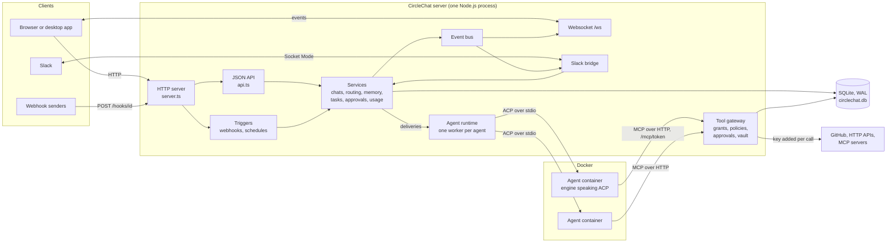
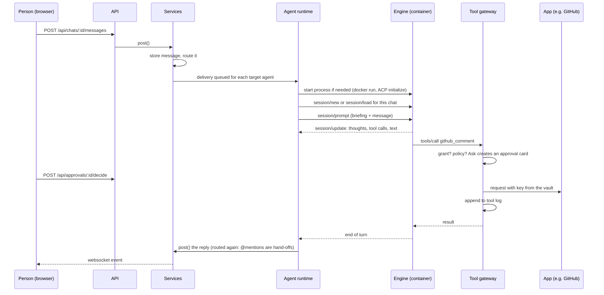

# Architecture

CircleChat is one Node.js process with a SQLite database, plus one Docker container per running agent. This page describes the components, how a message flows through them, the runtime and session model, and the database.

## Components

| Component | File | Role |
|---|---|---|
| Entry point | `server/src/index.ts` | Reads the environment, loads the vault key, applies the seed file, starts the listeners. |
| App | `server/src/app.ts` | Wires everything together. Model providers, engine install jobs, bridges. Used by the server and by tests. |
| HTTP server | `server/src/server.ts` | Routes `/mcp/*` to the gateway, `/hooks/*` to triggers, `/api/*` and `/sso` to the API, `/ws` to the websocket, everything else to the built web app. Also the narrow agent listener. |
| API | `server/src/api.ts` | The JSON API used by the web and desktop apps. Auth, roles, validation. See [HTTP API](api.md). |
| Services | `server/src/services.ts` | Chats, messages, routing, deliveries, approvals, memory, tasks, usage and budgets. Pure data and events. |
| Event bus | `server/src/bus.ts` | In-process events. The websocket forwards them to browsers, filtered per user. |
| Agent runtime | `server/src/agents/runtime.ts` | One supervisor per agent: process lifecycle, sessions, the turn loop, permission requests. |
| ACP client | `server/src/agents/acp.ts` | A minimal Agent Client Protocol v1 client: newline-delimited JSON-RPC 2.0 over the process's stdio. |
| Engines | `server/src/agents/engines.ts` | How to configure and start each engine. |
| Tool gateway | `server/src/gateway.ts` | The MCP server agents call. Core tools, connected apps, proxied MCP servers, grants, policies, approvals, the vault. |
| App catalog | `server/src/apps.ts` | Presets for the 22 token apps and the token check. |
| Tool log | `server/src/toollog.ts` | The hash-chained log of tool calls, and redaction. |
| Triggers | `server/src/triggers.ts` | Webhooks with HMAC and filters, cron schedules, runs and replay. |
| Slack bridge | `server/src/bridges/slack.ts` | Mirrors a Slack channel and a chat over Socket Mode. |
| Importer | `server/src/importer.ts` | Reads OpenClaw workspaces and Hermes homes. |
| Hosting | `server/src/hosting.ts` | Proxy trust, the seed file, export, erase, the Docker bridge address, hosted sign-in. |
| CLI | `server/src/cli.ts` | `export`, `backup`, `state`, `set-password-hash`. |
| Crypto | `server/src/crypto.ts` | scrypt passwords, the AES-256-GCM vault, ids, HMAC. |
| Web app | `web/` | React and Vite. Talks to the API and the websocket. |
| Desktop app | `desktop/` | A thin Electron shell around your server, with native notifications and a Dock badge. |
| Engine images | `engines/<id>/` | One Dockerfile per engine, plus launch scripts for Hermes and OpenClaw. |

## How a message flows

1. A person posts a message. `Services.post` stores it and works out which agents get it (see [Routing](agents.md#routing)).
2. Each target gets a **delivery** row in state `queued`. The runtime is told and starts that agent's work loop.
3. The worker starts the engine if it isn't running, opens or loads the ACP session for the chat, marks the delivery `injected` and sends the prompt.
4. While the turn runs, every ACP update (text, thoughts, tool calls, plans, usage) is streamed to the agent's activity log and to the browser.
5. When the engine calls a tool, it goes to the gateway over MCP. The gateway applies grants and policies, may wait for an approval, adds the key and logs the call.
6. When the turn ends, the reply text is posted to the chat with `Services.post`. If it mentions other agents, those are hand-offs with one more hop.
7. The delivery becomes `answered`, or `failed` with the reason.

Webhooks, schedules and the Slack bridge enter at step 1 or 2 the same way.

## Runtime and sessions

The runtime keeps **one long-lived engine process per agent** and **one ACP session per chat**.

| Concept | Detail |
|---|---|
| Worker | `AgentWorker`, one per agent, created on first use. Holds the process, the ACP connection, the open sessions and the status. |
| Process | `docker run -i --rm --init ...` for the `docker` sandbox, a child process for `local`. Speaks ACP on stdin and stdout. stderr goes to the activity log. |
| Session | One per chat, keyed by chat id in `agent_sessions`. Engine session ids are stored, so a session can be loaded again after a restart when the engine supports `session/load`. |
| Gateway token | Issued per session, tied to the agent, the chat and the current requester. Revoked when the session or process ends. Engines that can't take MCP servers per session (OpenClaw) get one agent-wide token, and the gateway reads the chat and requester from the agent's current turn. |
| Turn loop | One turn at a time per agent, from the `deliveries` queue in order. |
| Briefing | Sent once per session. Later turns get the messages from others since the agent's last turn. |
| Permission requests | ACP `session/request_permission` is answered from the autonomy level, or turned into an approval. |
| Status | stopped, starting, idle, working, waiting_approval, crashed, sleeping, budget. Sent on the bus. |

Lifecycle rules:

- **Start** on the first delivery, on warm-up, or on Wake.
- **Sleep** after 15 minutes idle. The process stops; sessions are loaded again on the next message.
- **Timeout** after 20 minutes in one turn: the turn is cancelled.
- **Crash**: the delivery fails with a message in the chat. The worker restarts only when more work is queued, with backoff from 1 second doubling to 60 seconds.
- **Server restart**: deliveries that were `injected` become `failed` ("server restarted mid-turn"). `queued` deliveries are picked up again.
- **Never retried**: a turn that failed is not run again automatically, because it may already have had side effects.

## Model calls

Engines call their model through CircleChat's model proxy (`server/src/agents/modelproxy.ts`), not the provider directly. When the runtime starts an engine it creates a stand-in token for that agent and gives the engine `<base>/llm/<token>/v1` (OpenAI-compatible and OpenAI) or `<base>/llm/<token>/anthropic` (Anthropic) as its model address. The proxy adds the real key, forwards to the provider's own address only, and streams the answer back. The token is revoked when the engine stops. Gemini CLI is the exception: it only talks to Google, so it gets the key itself.

## The database

SQLite through `node:sqlite`, one file in WAL mode with foreign keys on and a 5-second busy timeout. The schema is in `server/src/db.ts` and is created with `CREATE TABLE IF NOT EXISTS` at start.

| Table | Holds |
|---|---|
| `settings` | Key and value pairs: workspace name, providers, limits, hosting. |
| `users` | People: email, name, scrypt hash, role (`owner`, `admin`, `builder`, `member`). |
| `sessions` | Browser session tokens and expiry. |
| `agents` | Agents: handle, name, job, look, engine, model, instructions, autonomy, sandbox, budget. Deleted agents are archived. |
| `chats` | Chats: `group`, `dm` or `agents`. |
| `chat_members` | People and agents in each chat. |
| `chat_reads` | Last read time per person per chat. |
| `messages` | Messages: author, kind (`text`, `plan`, `approval`, `handoff`, `memory`, `system`, `error`, `trigger`), body, metadata. Timestamps are strictly increasing per chat. |
| `agent_sessions` | The engine session id per agent and chat. |
| `deliveries` | The work queue: target agent, chat, sender, text, hop, goal, state. |
| `approvals` | Approval requests, their options, state and decision. |
| `tool_calls` | The tool log, with `prev_hash` and `hash`. |
| `memories` | Long-term notes with scope `team`, `chat` or `agent`. Forgotten notes keep a timestamp. |
| `tasks` | Tasks, with their plan id and status. |
| `secrets` | Vault entries: name, IV, auth tag, ciphertext. |
| `connections` | Connected apps: kind (`github` or `http`), identity, owner, config, secret id. |
| `mcp_servers` | MCP servers: transport, URL or command, secret ids, the reviewed tool list. |
| `grants` | Where a connection or MCP server may be used. |
| `policies` | Allow, Ask, Block or Off per tool, optionally per chat. |
| `triggers` | Webhook and schedule triggers. |
| `trigger_runs` | Each webhook call or schedule run, with its body. |
| `usage` | Tokens and cost per agent per day. |
| `bridges` | Slack bridges. |
| `sso_used` | Used one-time sign-in tokens (hosted installs). |
