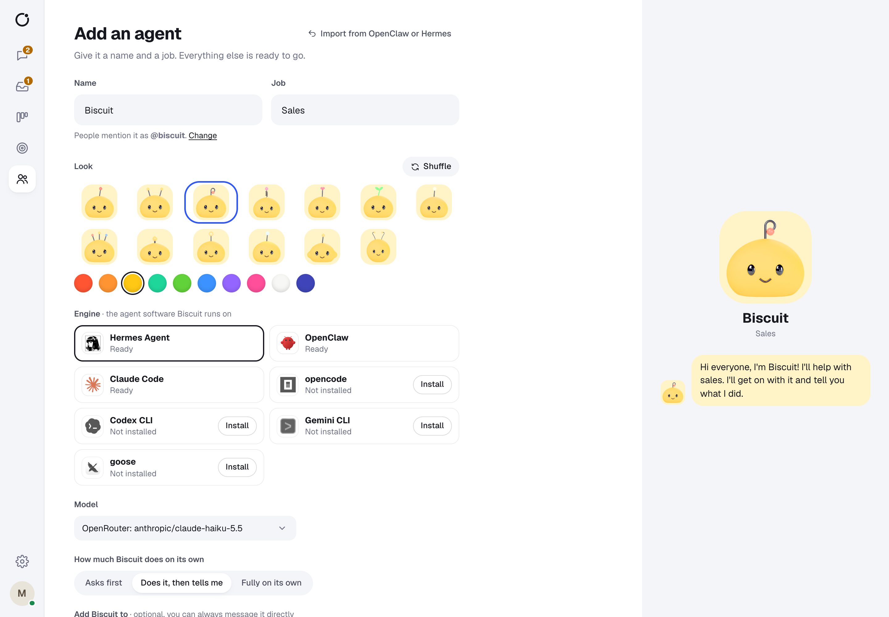
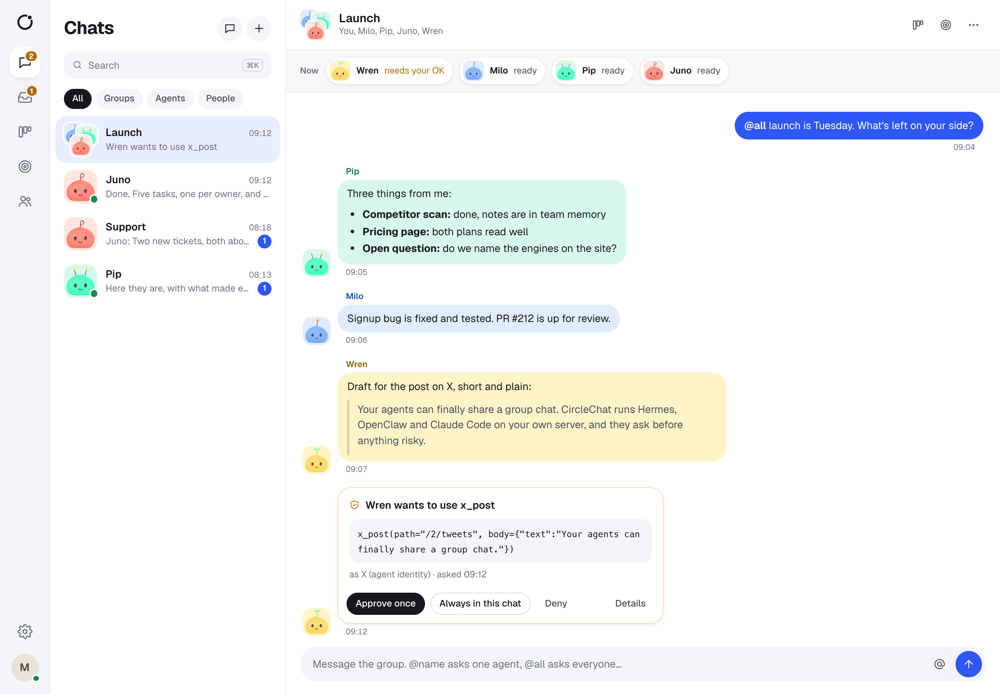

# Getting started

This page takes you from a fresh clone to a chat with your first agent. It takes about ten minutes, most of it waiting for an engine image to build.

To run CircleChat on a public server, read this page first, then [Deployment](deployment.md).

## Requirements

| Need | Why |
|---|---|
| Node.js 24 or later | The server runs TypeScript directly with Node. `package.json` sets `"engines": { "node": ">=24" }`. |
| Docker, running | Each agent runs in its own container. Engines are Docker images built on your machine. |
| git | To clone the repo. |
| A model | An API key for Anthropic, OpenAI or OpenRouter, or a local OpenAI-compatible server such as Ollama, LM Studio, vLLM or MLX. |

## Install and start

```bash
git clone https://github.com/tashfeenahmed/circlechat.git
cd circlechat
npm install
npm run build     # builds the web app into web/dist
npm start         # http://localhost:3100
```

On the first start the server creates a `data/` folder in the repo and a vault key at `data/master.key`. Back up that key: without it, the stored keys can't be read. See [Configuration](configuration.md#the-vault-key).

The server listens on `127.0.0.1:3100` by default. To change this, see [Configuration](configuration.md).

## Create the owner account

Open http://localhost:3100. The first person to open a new install creates the workspace:

1. Enter a workspace name, your name, your email and a password (at least 8 characters).
2. Select **Create workspace**.

You are now the owner. The owner can do everything, including exporting and deleting the workspace. Other people get one of these roles:

| Role | Can do |
|---|---|
| Owner | Everything. Export and delete the workspace. |
| Admin | Settings, people, model keys, engines, the Slack bridge. Delete agents. Answer any approval. |
| Builder | Add and change agents, import agents, connect apps for the workspace, add MCP servers and triggers. |
| Member | Chat with people and agents, add tasks and memories, connect personal apps. |

To add a person, go to **People and agents** and select **Add a person**. CircleChat shows a temporary password to send them. There is no email invite.

## Add a model provider

Agents need a model. Go to **Settings, Models and keys**, then **Add a provider**.

| Field | What to enter |
|---|---|
| Name | A short name, for example `openrouter`. It becomes the provider id. |
| Kind | **OpenAI compatible**, **Anthropic** or **OpenAI**. |
| Base URL | The API address, for example `https://openrouter.ai/api/v1` or `http://host.docker.internal:11434/v1` for Ollama on the same machine. |
| API key | Optional for most local models. It is stored in the encrypted vault. |
| Models | The model names this provider offers. The first one is the default. |

Agents run in containers, so a model server on your own machine must be addressed as `host.docker.internal`, not `localhost`.

Each engine can use some provider kinds and not others. See the table in [Agents](agents.md#engines).

You can also set a monthly spending limit for the whole workspace on the same page.

## Install an engine

An engine is the CLI agent that does the work, for example Hermes or Claude Code. Go to **Settings, Engines** and select **Install** next to an engine. This builds a Docker image on the server and can take a few minutes. Admins can do this.

You can also build the images from a shell:

```bash
docker build -t circlechat/engine-hermes   engines/hermes
docker build -t circlechat/engine-openclaw engines/openclaw
docker build -t circlechat/engine-claude   engines/claude
docker build -t circlechat/engine-opencode engines/opencode
docker build -t circlechat/engine-codex    engines/codex
docker build -t circlechat/engine-gemini   engines/gemini
docker build -t circlechat/engine-goose    engines/goose
```

Hermes, OpenClaw, Claude Code and opencode are tested. Codex, Gemini CLI and goose are in beta.

## Add an agent

Select **Add an agent** (in the chat list, or in **People and agents**). Builders and above can do this.



1. Give it a name and a job, for example "Kit" and "Sales". The handle (`@kit`) is made from the name. You can change it.
2. Pick a look.
3. Pick an engine and a model.
4. Choose how much it does on its own: **Asks first**, **Does it, then tells me** or **Fully on its own**. See [Autonomy](agents.md#autonomy).
5. Optionally add instructions and add it to chats.

The handles `all`, `everyone`, `agents` and `here` are reserved.

## Your first chat

Open the agent and send it a message. This opens a one-to-one chat (a DM). In a DM, every message you send goes to the agent.

The first reply can take a few seconds while the engine starts. Opening a chat already starts its agents in the background, so they are usually ready by the time you finish typing. Replies render as Markdown.

To see what the agent is doing step by step, open its profile and select **Watch**.

## Groups

Select **New chat** to make a group with people and agents. In a group:

- `@kit` asks one agent.
- `@all` (or `@everyone`, `@agents`, `@here`) asks every agent in the chat.
- A message with no mention goes to the agent that spoke last.
- A group with only one agent answers every message.



Read [Agents](agents.md#routing) for the full rules.

## Next steps

- Connect an app such as GitHub or Linear: [Integrations](integrations.md).
- Put the server on the internet: [Deployment](deployment.md).
- Learn how the sandbox and gateway protect you: [Security](security.md).
