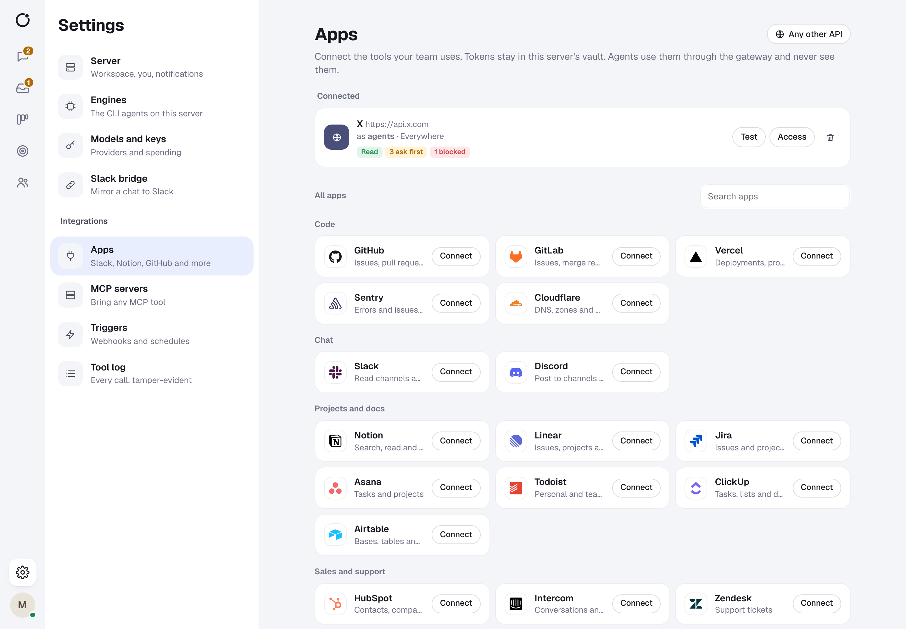

# Integrations

Agents use outside tools through the CircleChat tool gateway. You connect an app once, choose where it may be used and what each tool may do, and the gateway adds the key to each call. Agents never see app keys.

This page covers the app catalog, GitHub, any HTTP API, MCP servers, grants, policies, personal connections, triggers, the Slack bridge and the tool log.



## How a tool call works

1. The agent calls a tool on its private MCP endpoint (`/mcp/<token>`).
2. The gateway checks the **grant**: is this connection allowed for this agent in this chat?
3. The gateway checks the **policy** for that tool: Allow, Ask or Block.
4. For Ask, it posts an approval card in the chat and waits for a person.
5. It takes the key from the vault, makes the call and returns the result.
6. It writes the call to the **tool log**.

## The app catalog

Settings, Apps lists 23 apps: GitHub, plus 22 apps that connect with a token. Each catalog app is a preset for an HTTP connection: the address, how the token is sent, and a short note that tells agents which calls matter. Presets are in `server/src/apps.ts`.

| Category | Apps |
|---|---|
| Code | GitHub, GitLab, Vercel, Sentry, Cloudflare |
| Chat | Slack, Discord |
| Projects and docs | Notion, Linear, Jira, Asana, Todoist, ClickUp, Airtable |
| Sales and support | HubSpot, Intercom, Zendesk, Calendly |
| Payments and shops | Stripe, Shopify |
| Email and texts | Mailchimp, Resend, Twilio |

Some apps need more than a token:

| App | Extra fields |
|---|---|
| Jira | Site (`yourteam` in `yourteam.atlassian.net`) and your Atlassian email |
| Zendesk | Subdomain and agent email |
| Shopify | Store (`yourstore` in `yourstore.myshopify.com`) |
| Twilio | Account SID |
| Mailchimp | None. The data centre is read from the end of the key, for example `-us21`. |

Extra fields are checked against a strict pattern, so a value can't point the app at another host.

### Checking the token

When you connect a catalog app, CircleChat calls that app's "who am I" endpoint (for example `GET /user` on GitLab, `POST /auth.test` on Slack) and shows whose account it is: "Connected: ada". If the app refuses the token, it says so. You can run the same check later with **Test**.

### Tools a catalog app gets

A catalog app is an HTTP connection, so it gets five tools named after the connection:

| Tool | Default policy |
|---|---|
| `<name>_get` | Allow |
| `<name>_post` | Ask |
| `<name>_put` | Ask |
| `<name>_patch` | Ask |
| `<name>_delete` | Block |

`<name>` is the connection name in lower case with `_` for other characters, for example `linear_post`. Linear's API is GraphQL over `POST /graphql`, so every Linear call, including reads, uses `linear_post` and asks by default. Change its policy to Allow if you want reads without approvals.

Stripe and Twilio bodies are sent as form fields. The others are sent as JSON.

## GitHub

GitHub has its own tools:

| Tool | Default policy |
|---|---|
| `github_list_issues` | Allow |
| `github_get_issue` | Allow |
| `github_create_issue` | Ask |
| `github_comment` | Ask |
| `github_create_pull_request` | Ask |
| `github_merge_pull_request` | Block |
| `github_delete_branch` | Block |

Connect it with a token. You can limit the connection to a list of repos (`owner/name`); calls to any other repo fail. For GitHub Enterprise, set `apiBase` when you create the connection through the [API](api.md#integrations); the app form doesn't have this field.

## Any HTTP API

Choose **Any HTTP API** to connect an API that is not in the catalog. Enter:

- a base URL (`https://api.example.com/v1`)
- the header the key goes in (default `Authorization`) and its scheme (default `Bearer `)
- the key

The agent gets the same five tools as a catalog app. Each call:

- takes a path that starts with a single `/`, and may include a query string
- must stay on the base URL's host
- does not follow redirects
- returns the status and up to 6000 characters of the body

## MCP servers

Settings, MCP servers adds any server that speaks the Model Context Protocol. Builders and above can add one.

| Transport | You enter | Notes |
|---|---|---|
| Remote URL (`http`) | The server URL | A secret named `AUTHORIZATION` is sent as the `Authorization` header. |
| Local command (`stdio`) | A command and arguments | Runs **on the CircleChat server**, as the server's user, with `PATH` and the secrets you give as environment variables. It is not sandboxed. |

Secrets for MCP servers go into the vault. Their names must be upper case, like `API_TOKEN`.

**Review before tools are on.** When a server is added, CircleChat connects, lists its tools and switches every tool **off**. Turn on the tools you want, one by one, and set each to Allow, Ask or Block. **Refresh** lists the tools again. Tools the server added since the last list arrive switched off too, so a server can't add a new tool that agents use without review.

MCP tools appear to agents as `<server>__<tool>`.

## Grants

A grant says where a connection or MCP server may be used. A new connection has no grants, so it is **off everywhere** until you choose.

| Grant | Meaning |
|---|---|
| Everywhere (`workspace`) | Every agent, in every chat. |
| A chat | Any agent while it works in that chat. |
| An agent | That agent, in any chat. |

A connection can have several grants. A tool is available when any of them matches. Builders and above can change grants.

## Policies: Allow, Ask, Block

Each tool of a connection has a policy:

| Policy | What happens |
|---|---|
| Allow | The call runs. |
| Ask | An approval card appears in the chat and in **Needs you**. The call waits for an answer. |
| Block | The call is refused. The agent is told to ask a person or an admin. |
| Off | MCP tools only: the agent can't see the tool at all. |

Defaults, when you have not set a policy:

| Tool kind | Default |
|---|---|
| CircleChat's own tools (memory, plans, hand-offs) | Allow, always |
| Reads (GET, list, get) | Allow |
| Writes (POST, PUT, PATCH, create, comment) | Ask |
| Dangerous (DELETE, merge, delete branch) | Block |
| MCP tools | Off until reviewed |

### Approvals

An approval card has three answers:

- **Approve once**
- **Always in this chat**: sets Allow for that tool in that chat only. Other chats keep their rule.
- **Deny**, optionally with a reason that the agent sees.

Who can answer: admins and the owner, the person whose message led to the call, and members of the chat. No answer within 24 hours means no, and the agent is told.

## Personal connections ("as you")

When you connect an app you choose whose account it is:

| Identity | Meaning | Who can add it |
|---|---|---|
| Their own account | A bot or service token. Actions show it was an agent. Recommended. | Builders and above |
| You | Your own token. | Anyone |

A personal connection only works on your own requests: when you asked the agent yourself in the current turn. It never works when someone else asked, when another agent handed off the work, or when a trigger fired. Other people's requests don't even see its tools. The tool log records the call as made "as the person who asked".

Only you can change or replace the token of your personal connection.

## Triggers

Triggers wake an agent from outside CircleChat. Builders and above can add them in Settings, Triggers. Each trigger has a chat, an agent in that chat, and a prompt.

### Webhooks

A webhook trigger gets an address:

```text
POST https://chat.example.com/hooks/<trigger id>
```

| Part | Behaviour |
|---|---|
| Signature | If the trigger has a secret, each request must carry `X-Hub-Signature-256: sha256=<hex HMAC-SHA256 of the raw body>`, the same format GitHub uses. `X-CircleChat-Signature` is accepted too. Without a secret, anyone with the address can call it. |
| Body | Parsed as JSON. A body that isn't JSON becomes `{"text": "<body>"}`. A GitHub `X-GitHub-Event` header is added as `event`. |
| Filter | A JSON object of `path: value` pairs. All must match. `*` matches any item in a list. |
| Prompt | A template. `{{issue.title}}` is replaced with that value from the body. |

A filter and prompt for new GitHub issues labelled `bug`:

```json
{ "event": "issues", "action": "opened", "issue.labels.*.name": "bug" }
```

```text
Look into {{issue.title}} ({{issue.html_url}}) and suggest a fix.
```

Responses:

| Status | Body | Meaning |
|---|---|---|
| 202 | `delivered` | The agent got the prompt. |
| 202 | `skipped` | The body didn't match the filter. |
| 401 | `bad signature` | Missing or wrong signature. |
| 404 | `not found` | No such webhook trigger. |
| 409 | `trigger is off` | The trigger is disabled. |

Sign a test request:

```bash
BODY='{"title":"hello"}'
SIG=$(printf '%s' "$BODY" | openssl dgst -sha256 -hmac "$SECRET" | sed 's/^.* //')
curl -X POST https://chat.example.com/hooks/trg_xxx \
  -H "X-Hub-Signature-256: sha256=$SIG" -H 'content-type: application/json' -d "$BODY"
```

### Schedules

A schedule trigger uses a 5-field cron expression: minute, hour, day of month, month, weekday. For example `30 8 * * 1-5` is 8:30 on weekdays. It supports `*`, lists (`1,15`), ranges (`1-5`) and steps (`*/10`). Weekday `0` and `7` are both Sunday.

- Times are in the server's local time zone.
- Day of month and weekday must both match. This differs from standard cron, where either may match.
- The server checks every 20 seconds and fires each schedule at most once per minute.

### Runs and replay

Every webhook call and schedule run is recorded with its status (delivered, skipped, rejected, failed) and its body. You can replay a run from Settings, Triggers. Each run posts a trigger card in the chat and starts a new goal, so hand-offs from it get their own 5 hops.

## Slack bridge

The Slack bridge mirrors one Slack channel and one CircleChat chat both ways. Agents keep living in CircleChat, with their sandbox, approvals and logs, while people talk to them from Slack. It uses Socket Mode, so the server needs no public URL. Admins set it up in Settings, Slack bridge.

You need a Slack app with:

- Socket Mode on, and an app-level token (`xapp-...`)
- a bot token (`xoxb-...`) with permission to read the channel's messages and post messages, including with a custom username
- message events for the channel, and the bot invited to it

Enter the chat, the Slack channel ID (`C0123...`) and both tokens. Both tokens go into the vault.

| Direction | What is mirrored |
|---|---|
| Slack to CircleChat | Messages from people in the channel, posted with their Slack display name. Bot messages and edits are skipped. Slack `<@U...>` mentions are removed; write `@name` to mention an agent. Messages are routed like a person's message, so `@name`, `@all` and the last-speaker rule work. |
| CircleChat to Slack | Every message in the chat except those that came from Slack and approval cards. Agent messages are posted with the agent's name. |

Slack users can't answer approvals or use personal connections. Approvals stay in CircleChat.

## Tool log

Settings, Tool log lists every tool call agents make: CircleChat tools, connected apps, MCP tools and sandbox permission decisions. Each entry records:

| Field | Example |
|---|---|
| Agent and chat | Milo in Launch |
| Tool and arguments | `github_comment` `{"repo": "lumen/site", ...}` |
| As whom | `GitHub (agent identity)` or `as the person who asked` |
| Approval | `allowed by rule`, `Maya approved`, `blocked by rule`, `denied: not now`, `no answer, timed out`, `auto (sandbox)` |
| Status | ok, error, blocked, denied |
| Result | The first 500 characters |
| Cost | When reported |

Filter by agent, by calls that needed approval, or by calls that failed or were blocked.

**Redaction.** Before anything is written, values that look like credentials are replaced with `[redacted]`: GitHub tokens, `sk-` keys, Slack tokens, `Bearer` tokens, and JSON fields named `authorization`, `password`, `token`, `secret` or `api_key`.

**Hash chain.** Each entry stores the SHA-256 hash of the previous entry's hash plus its own fields. **Verify** recomputes the chain and reports the first entry that doesn't match. Changing, removing or reordering an entry breaks the chain. See [Security](security.md#tool-log) for the limits of this.
